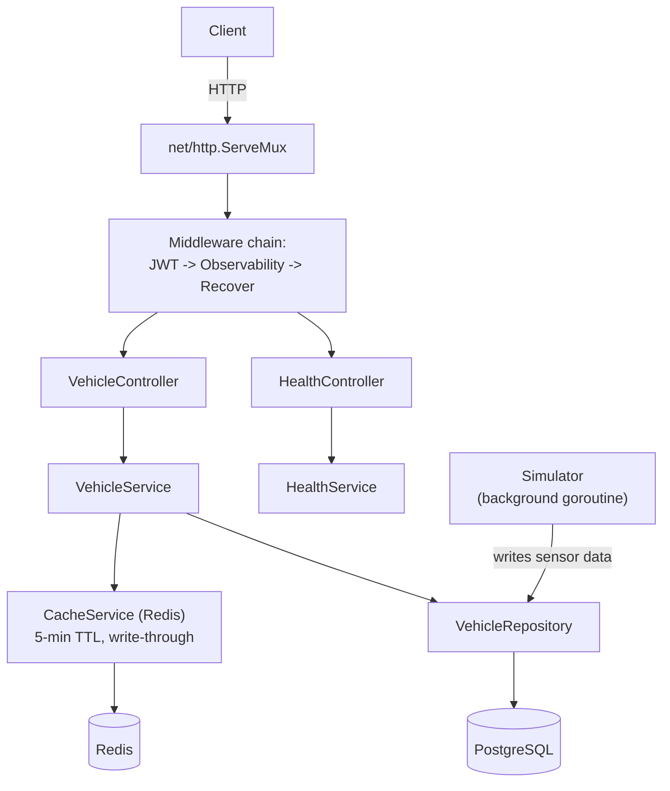

# Fleet Tracking Backend Service

[](https://github.com/saadbutt/fleet-tracking-backend/actions/workflows/ci.yml)

A REST API for real-time vehicle location and trip history. JWT auth,
PostgreSQL, Redis caching, Swagger docs, Docker Compose.

## Tech stack

- **Language:** Go, `net/http`'s standard library `ServeMux` — no web
  framework
- **Database:** PostgreSQL (`lib/pq`), with versioned SQL migrations
- **Cache:** Redis (`redis/go-redis/v9`), write-through invalidation with a
  5-minute TTL
- **Auth:** JWT (`golang-jwt/jwt/v5`)
- **Docs:** Swagger/OpenAPI (`swaggo`), served at `/swagger/`
- **CI:** GitHub Actions — gofmt, vet, full suite, race detector, arm64
  cross-compile

## Architecture



The simulator runs as a background goroutine seeded against the first
vehicle in the database — it's what makes `/api/vehicle/status` return
moving data without a real GPS device attached. Full schema and caching
rationale: [`docs/README.md`](./docs/README.md).

## Measurable results

- **0 vulnerabilities** — `govulncheck ./...` reports a clean scan
- **5 test functions, 30 cases** including table-driven subtests —
  `go test ./internal/...`
- **CI green** on gofmt, vet, the full suite, the race detector, and an
  arm64 cross-compile, on every push

## Installation & Setup instructions

### Prerequisites

- **Docker & Docker Compose** 
- **Go 1.25+**
- **PostgreSQL 15+**
- **Redis 7+** 

### Option 1: Docker Compose

```bash
# Clone the repository
git clone https://github.com/saadbutt/fleet-tracking-backend
cd fleet-tracking-backend

# docker-compose.yml falls back to an insecure dev-only JWT secret.
# Set your own before running anything beyond local dev:
# echo "JWT_SECRET=$(openssl rand -hex 32)" > .env

# Start all services
docker-compose up -d

# Run migration to populate data
docker exec -i fleet-tracking-postgres psql -U postgres -d fleet_tracking < migrations/001_complete_schema.sql

# Get vehicle Id to use in APIs
docker exec -it fleet-tracking-postgres psql -U postgres -d fleet_tracking -c "SELECT id, plate_number, created_at FROM vehicle;"

# Generate JWT token
go run scripts/generate_token.go

```

The API will be available at: `http://localhost:8080` and Swagger will be available at: http://localhost:8080/swagger

### Option 2: Local Development

```bash

go mod tidy

# Set up environment variables
cp .env.example .env

# Populate .env with required configurations

createdb fleet_tracking -U postgres

psql -h localhost -U postgres -d fleet_tracking -f migrations/001_complete_schema.sql

# Note: The sensor simulation will automatically start for the first vehicle in the database

# Run the application
go run cmd/api/main.go
```

## Run TestCase

```bash
# Run all unit tests
go test ./internal/... -v
```

## API Documentation

### Base URL
```
http://localhost:8080
```

### Authentication
All API endpoints require JWT authentication. Include the token in the Authorization header:
```
Authorization: Bearer <your-jwt-token>
```

### Generate Test Token
```bash
TOKEN=$(go run scripts/generate_token.go)
curl -H "Authorization: Bearer $TOKEN" http://localhost:8080/api/vehicle/status?vehicle_id=<id>
```

### Swagger Documentation
Visit `http://localhost:8080/swagger/` for interactive API documentation.

## API Endpoints

### 1. Health Check

```bash
# Check service health
curl -X GET http://localhost:8080/health
```

### 2. Get Vehicle Status

```bash
# Get current vehicle status
curl -X GET "http://localhost:8080/api/vehicle/status?vehicle_id=:vehicleId" \
  -H "Authorization: Bearer <your-jwt-token>"
```

**Response:**
```json
{
  "vehicle_id": ":vehicleId",
  "plate_number": "ABC-123",
  "last_status": {
    "location": [25.2048, 55.2708],
    "speed": 60.5,
    "timestamp": "2025-10-13T10:00:00Z"
  },
  "last_updated": "2025-10-13T10:00:00Z"
}
```

### 3. Get Trip History

```bash
# Get trip history for past 24 hours
curl -X GET "http://localhost:8080/api/vehicle/trips?vehicle_id=:vehicleId&hours=2" \
  -H "Authorization: Bearer <your-jwt-token>"
```

**Response:**
```json
{
  "trips": [
    {
      "id": "trip-uuid-1",
      "vehicle_id": ":vehicleId",
      "start_time": "2025-10-13T09:00:00Z",
      "end_time": "2025-10-13T09:30:00Z",
      "mileage": 15.5,
      "avg_speed": 45.2
    }
  ],
  "count": 1
}
```

### 4. Ingest Vehicle Data

```bash
# Ingest new vehicle data
curl -X POST http://localhost:8080/api/vehicle/ingest \
  -H "Content-Type: application/json" \
  -H "Authorization: Bearer <your-jwt-token>" \
  -d '{
    "vehicle_id": ":vehicleId",
    "status": {
      "location": [25.2048, 55.2708],
      "speed": 60.5,
      "timestamp": "2025-10-13T10:00:00Z"
    }
  }'
```

**Response:**
```json
{
  "message": "Vehicle data ingested successfully",
  "vehicle_id": "550e8400-e29b-41d4-a716-446655440000"
}
```

## Demo output

Swagger UI is a real browser GUI, not something a terminal can capture, so
rather than fake a screenshot, here's the stack actually running end to end —
`docker compose up`, a real migration, a real JWT token, a real request:

```
$ curl -s http://localhost:8080/health
{"status":"healthy","message":"All systems operational","timestamp":"2026-10-23T13:10:51Z","version":"1.0.0"}

$ TOKEN=$(go run scripts/generate_token.go)
$ curl -s "http://localhost:8080/api/vehicle/status?vehicle_id=$VID" -H "Authorization: Bearer $TOKEN"
{"vehicle_id":"b6665aa0-b3e0-4302-b75b-27a61231e9a5","plate_number":"ABC-123","status":{"location":[25.2278,55.2707],"speed":103.78,"timestamp":"2026-10-23T13:11:10Z"},"last_updated":"2026-10-23T13:11:10Z"}
```

The moving location and speed aren't fixture data — that's the background
simulator writing real rows the whole time this ran. Swagger UI itself is at
`http://localhost:8080/swagger/` once the stack is up; open it in a browser to
see it directly, it's a real GUI.

## API Testing

### Swagger UI
The easiest way to test the API is using the built-in Swagger UI:
1. Start the services: `docker-compose up -d`
2. Open your browser: `http://localhost:8080/swagger/`
3. Use the "Authorize" button to set your JWT token
4. Test all endpoints directly in the browser

##  Design Decisions

Detailed Design Decisions are provided here: [`README/`](./docs/README.md)

